

[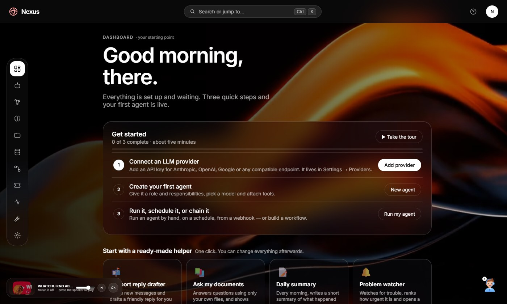](https://tootenramen.github.io/nexus-prototype/)

# NEXUS

### Your AI agents, finally somewhere calm.

Build agents. Wire them into workflows. Watch them think. All in a glass-smooth interface that explains itself, with a friendly guide in the corner and a soundtrack that hits.

   

### [▶ Try the live demo](https://tootenramen.github.io/nexus-prototype/) &nbsp;·&nbsp; [🧊 Frost](https://tootenramen.github.io/nexus-prototype/frost.html) &nbsp;·&nbsp; [🌋 Lava](https://tootenramen.github.io/nexus-prototype/lava.html)

---

## Why you will love it

- **Zero setup.** Open the link and you are inside. No account, no install, no config.
- **It teaches itself.** A guided walkthrough opens on its own and a help guide is always one click away.
- **It is beautiful on purpose.** Real glass, a magnifying dock, a slow-moving lava backdrop, and two complete looks.
- **It is fast to understand.** Every empty page says what it is for and what to do next.
- **It is private.** Everything you make stays in your own browser.

---

## Build a workflow by dragging

Drop steps on a live canvas, pull a wire from one to the next, press **Run**, and watch the data glow its way through. Triggers, agents, branches, transforms, parallel steps and outputs, all draggable.

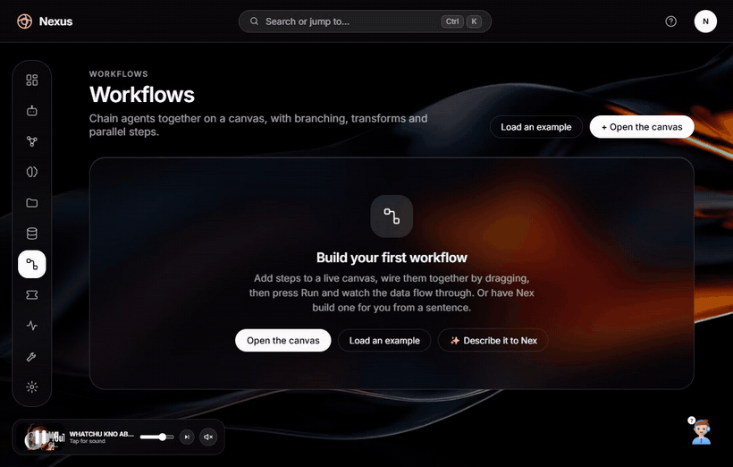

---

## Talk to Nex. Watch it build itself.

Press **V** (or tap Nex, then **Talk to Nex**) and say what you want. Nex repeats it back in plain words, then builds the whole thing on screen: the trigger, the data fetch, the agent, the approval checkpoint and the destination pop onto the canvas one by one, wires drawing between them, with a soft chime on every step. Then he runs it. The music ducks while he talks and comes back after.

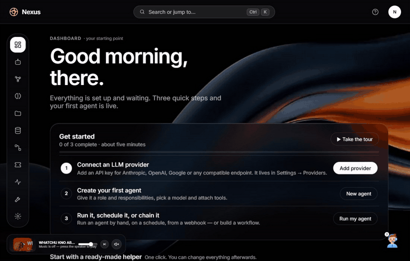

| 1. Press V | 2. Say it | 3. Watch it build | 4. It runs |
|---|---|---|---|
| 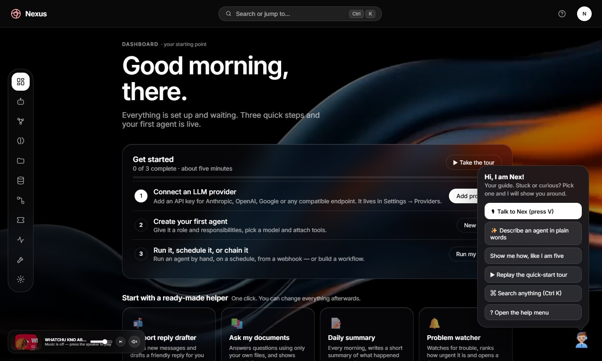 | 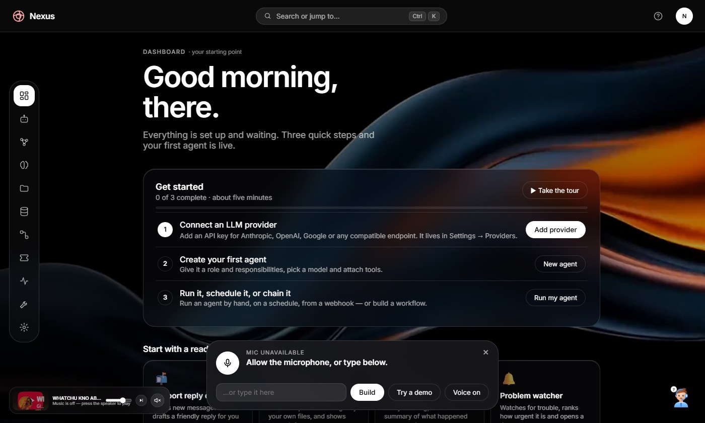 | 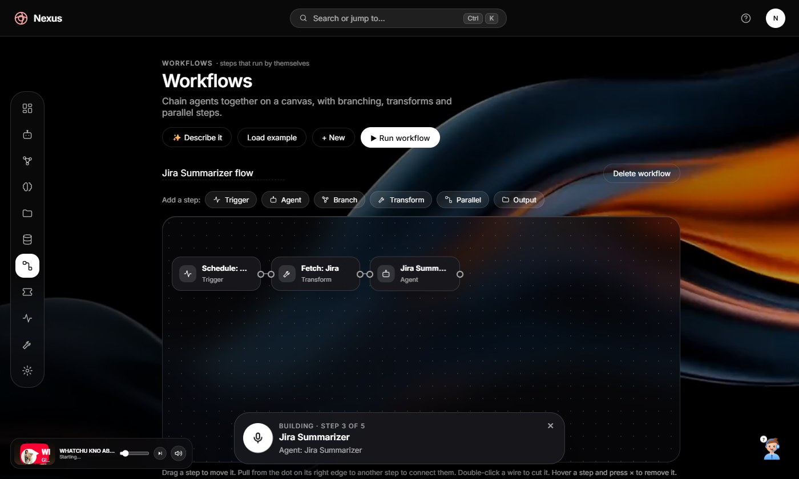 | 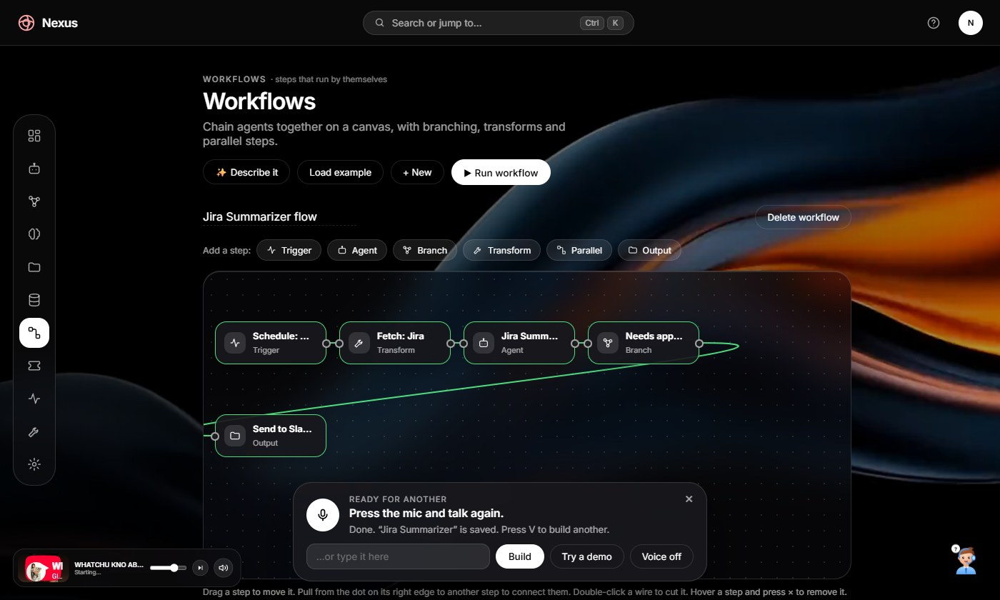 |

No microphone, or a browser without speech recognition? Type it, or tap **Try a demo**. Voice replies can be switched off with **Voice on / off**. Speech recognition is built into Chrome and Edge and runs through the browser; Nexus itself sends nothing anywhere.

---

## Say it in a sentence. Nex builds it.

Type what you want in plain English. Nex picks the role, the tools and the trigger, then lays the whole workflow out for you.

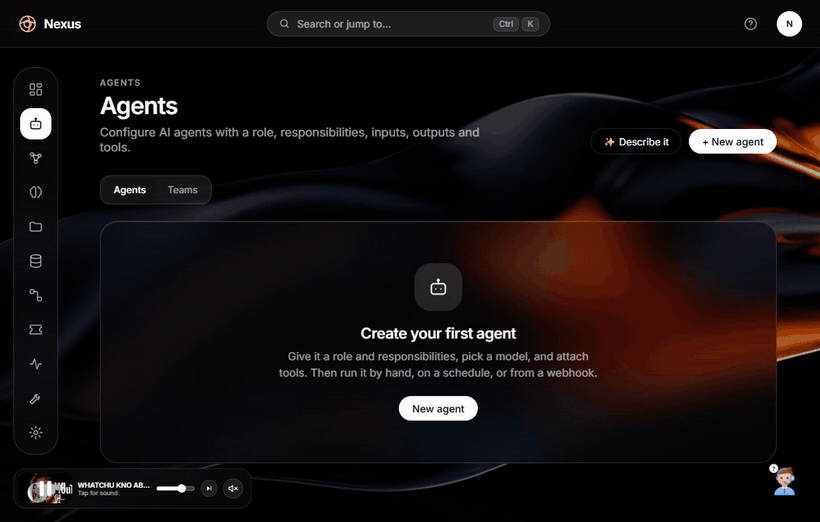

> *"Every weekday at 9, summarize new Jira tickets and post them to Slack, ask me to approve first."*
> becomes a Jira Summarizer agent, a schedule trigger, an approval branch and a Slack output, wired up and ready to run.

---

## Watch your agent think

Press Run and a live window opens: the plan, the tool calls, a token counter, a cost meter ticking up. When it finishes, drag the slider to **replay the whole run** step by step.

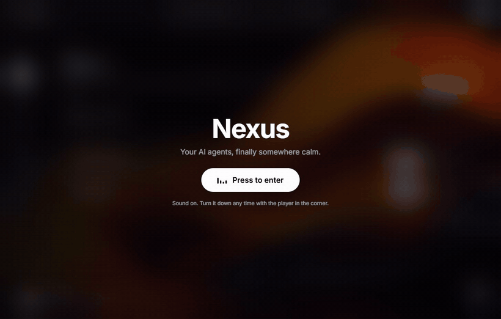

---

## A tour anyone can follow

Six short stops that spotlight exactly where things live, with arrow-key support. It opens by itself on the demo pages, and the help button brings it back any time.

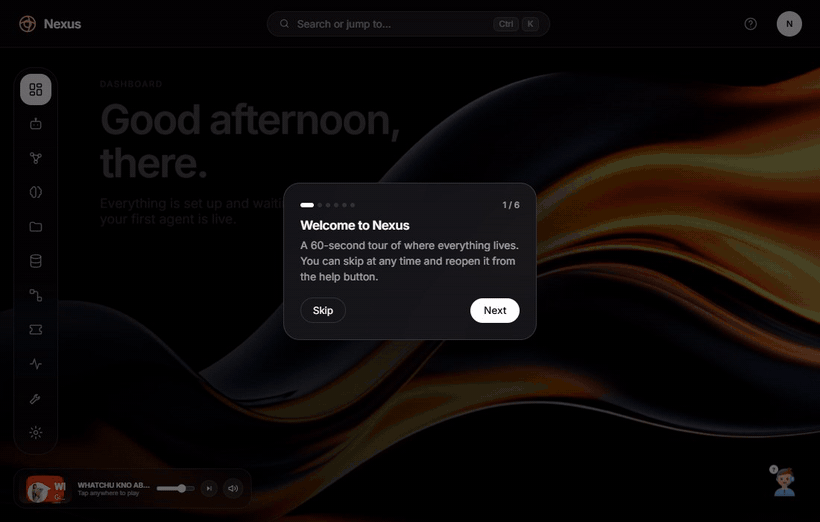

---

## Two looks. Pick your mood.

**Frost** is light, airy glass over a slow-drifting icy-blue silk, with a magnifying dock. **Lava** is dark glass over a slow, smooth lava backdrop, with a slim rail. Both backgrounds are real video, slowed down and frame-blended so they glide. Switch any time.

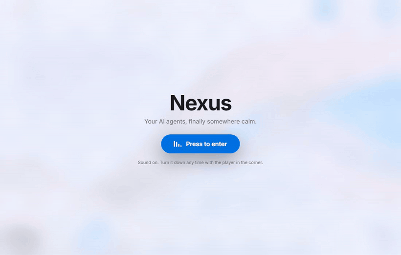

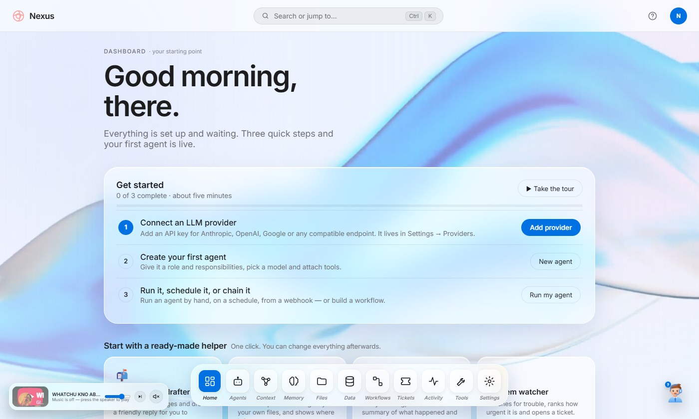

---

## Everything inside

| | |
|---|---|
| **11 pages** | Dashboard, Agents, Context, Memory, Files, Databases, Workflows, Tickets, Activity, Tools, Settings |
| **Workflow canvas** | Drag, connect, run, and watch the data flow |
| **Run theater** | Live agent trace, token and cost meters, replay slider |
| **Voice mode** | Press V and talk: Nex builds, wires and runs the agent while you watch |
| **Describe-it builder** | Plain English in, agent and workflow out |
| **Nex, your guide** | Animated help character with the tour, search and help one click away |
| **Quick-start tour** | Spotlight walkthrough, keyboard friendly |
| **Animated tutorial** | Five short lessons with looping demos, explained like you are five |
| **Command palette** | Ctrl K (Cmd K on Mac) to jump anywhere |
| **Get-started checklist** | Connect a provider, create an agent, run it, and watch it tick off |
| **Ready-made helpers** | One-click starters (support replies, ask-my-documents, daily summary, problem watcher) |
| **Soundtrack** | Optional playlist. Off by default: press the speaker to play |

---

## Try it in 30 seconds

1. Open the [live demo](https://tootenramen.github.io/nexus-prototype/), tap **Next** through the tour (music is off until you press the speaker).
2. Press **✨ Describe it** and type what you want an agent to do.
3. Hit **Run workflow** and watch it go.
4. Tap **Nex** in the corner and choose **Show me how, like I am five** for a five-lesson animated tutorial.

---

## Under the hood

Plain HTML, CSS and JavaScript. No build step, no framework, no server. Everything you create is saved in your own browser and nothing is sent anywhere. This repository is the source of truth: `index.html` (both looks), `frost.html` and `lava.html` (one look each), `nexus-extras.js` (the workflow canvas, run theater and describe-it builder) and `docs/` (screenshots and the animations above).

**Honest notes:** this is a design prototype, not the finished product. The agent runs and the describe-it builder are simulated in your browser, with no real AI model called. The documentation and support links are placeholders. The font and the Lava backdrop load from the web, so it needs a connection. The playlist streams from YouTube, so on iPhone it starts after the first tap.

**Skills this shows:** product and interaction design, glassmorphism with accessible contrast, drag-and-drop canvas and live animation in plain JavaScript, a guided onboarding walkthrough, character animation in SVG and CSS, single-folder front-end engineering, privacy-first client-side design.

---

Built by Gustavo Freitas &nbsp;·&nbsp; [LinkedIn](https://www.linkedin.com/in/gustavo-freitas-69b93910b/) &nbsp;·&nbsp; [more projects](https://github.com/Tootenramen)

